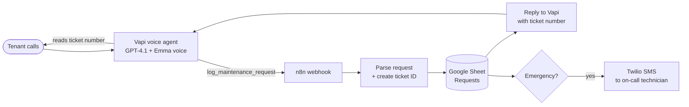

# AI Maintenance Intake Agent for Property Managers

A 24/7 voice agent that answers tenant maintenance calls, collects every detail a technician needs, sorts each request by urgency, logs it automatically, and texts the on-call tech the moment there's an emergency.

**Built with:** Vapi · OpenAI GPT-4.1 · n8n · Google Sheets · Twilio

---

## The problem

Property managers lose time and money on maintenance calls:

- **After-hours calls go to voicemail.** A burst pipe at 2 a.m. becomes a flooded unit by morning.
- **Messages are incomplete.** "Something's leaking, call me back" means a second call before anyone can act.
- **Everything looks equally urgent.** A dripping tap and a gas smell land in the same inbox.
- **Staff spend hours retyping** voicemails into a tracker.

## What this system does

| | |
|---|---|
| 📞 **Answers every call, 24/7** | No voicemail, no hold music |
| 🚨 **Puts safety first** | Fire, gas and flooding get safety instructions before any questions |
| 📝 **Collects complete details** | Name, callback number, address, unit, issue, access permission, pets, preferred time |
| 🔺 **Sorts by urgency** | `emergency` / `urgent` / `routine`, with clear rules and the higher level picked when unsure |
| 🗂️ **Logs it automatically** | Every request becomes a ticket row in Google Sheets, swappable for any CRM or PM software |
| 📲 **Alerts on-call staff instantly** | Emergencies trigger an SMS with everything the technician needs |
| 🎫 **Confirms with a ticket number** | The tenant hangs up knowing exactly what happens next |

## How it works



### Call flow

1. **Safety check:** the first message asks about fire, gas or flooding, so real emergencies get handled in the first seconds.
2. **Intake:** the agent asks one question at a time and skips anything the tenant already said.
3. **Triage:** it classifies the issue (plumbing, electrical, HVAC, appliance, pest, lockout/security, structural, other) and its urgency.
4. **Log:** it calls the `log_maintenance_request` tool, and n8n writes the ticket and returns a ticket number.
5. **Close:** it reads back the ticket number and the expected response time for that urgency level.

See a full example in [docs/sample-call.md](docs/sample-call.md).

### Urgency rules

| Level | Examples | Tenant is told |
|---|---|---|
| **Emergency** | Fire/smoke, gas smell, flooding, sewage backup, no heat in freezing weather, live wires, unit can't be locked | On-call tech alerted now; callback within 30 minutes |
| **Urgent** | No hot water, fridge not cooling, only toilet broken, AC out in extreme heat | Team calls first thing in the morning |
| **Routine** | Dripping tap, loose cabinet, light fixture, minor pests | Team calls within 1–2 business days |

## Repository structure

```
├── agent/
│   ├── system-prompt.md               # Full agent instructions: persona, safety, intake, triage, rules
│   ├── assistant.json                 # Vapi assistant config (model, voice, transcriber)
│   └── tools/
│       └── log-maintenance-request.json  # Function-tool schema the agent calls
├── n8n/
│   └── maintenance-intake-workflow.json  # Importable n8n workflow
└── docs/
    ├── sample-call.md                 # Example conversation + what happens behind the scenes
    └── google-sheet-template.csv      # Column headers for the Requests sheet
```

## Setup

**You'll need:** a Vapi account, an n8n instance (cloud or self-hosted), a Google account, and a Twilio number for SMS alerts.

1. **Google Sheet:** create a sheet with a tab named `Requests`, and paste the headers from `docs/google-sheet-template.csv` into row 1.
2. **n8n:**
   - Import `n8n/maintenance-intake-workflow.json`.
   - In **Log to Google Sheet**, connect your Google credentials and set your sheet ID.
   - In **SMS on-call technician**, connect Twilio and set the `from` and `to` numbers.
   - Activate the workflow and copy the production webhook URL.
3. **Vapi tool:** create a function tool from `agent/tools/log-maintenance-request.json`, and set its server URL to your n8n webhook.
4. **Vapi assistant:** create an assistant using `agent/assistant.json`. Paste `agent/system-prompt.md` into the system prompt, replace `{{COMPANY_NAME}}`, and attach the tool.
5. **Phone number:** buy or import a number in Vapi, assign the assistant, and point the property manager's after-hours line to it.
6. **Test:** call it with a routine request and an emergency. Check that the sheet row appears and the SMS arrives.

## Customizing for a client

- **Branding:** company name, agent name and voice.
- **Response times:** match the promises in the urgency table to the client's real SLAs.
- **Where tickets go:** swap Google Sheets for AppFolio, Buildium, Airtable, HubSpot or email. Only the n8n logging node changes.
- **Escalation:** add a phone call (not just SMS) or a backup technician if the first doesn't acknowledge.
- **Languages:** the stack supports multilingual voices and transcription for non-English tenants.

## Contact

Built by **Muhammad Saeed ur Rehman**, business systems & automation builder.

📫 [saeedspace101@gmail.com](mailto:saeedspace101@gmail.com) · 💼 [LinkedIn](https://www.linkedin.com/in/muhammad-saeed-ur-rehman-57043724b)

Want this set up for your properties, or a similar system for your business? Get in touch.
